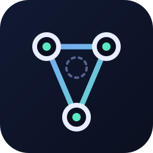
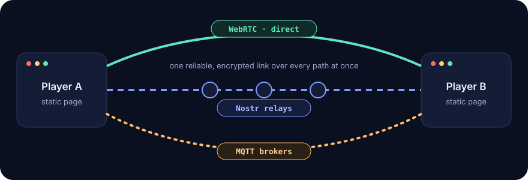

<div align="center">



# hostless

**Multiplayer for static sites that refuses to disconnect.**

WebRTC when it works · public relays when it doesn't · matches that survive reloads · progress on every device — and no server of your own.

**English** | [Русский](README.ru.md)

[](https://github.com/NELKIO/hostless/actions/workflows/ci.yml)
[](https://www.npmjs.com/package/hostless)
[](https://www.npmjs.com/package/hostless)
[](docs/testing.md)
[](#install)
[](LICENSE)
[](https://github.com/NELKIO/hostless/stargazers)

[](https://www.typescriptlang.org/)
[](https://webrtc.org/)
[](https://nostr.com/)
[](https://mqtt.org/)
[](https://pages.github.com/)

[**Live demos**](https://nelkio.github.io/hostless/) · [Docs](docs/architecture.md) · [npm](https://www.npmjs.com/package/hostless) · [For AI agents](AGENTS.md)

</div>

<br>

<p align="center">
  
</p>

## Why hostless

You built a browser game on GitHub Pages. Now you want friends to play it together — and you do not
want a server, a database, accounts or a monthly bill. Plain WebRTC gets you halfway: it breaks
behind symmetric NATs, VPNs, corporate Wi‑Fi and some mobile carriers, and a reload loses the game.

hostless is the other half, extracted from three games played across countries over flaky networks:

<table>
<tr>
<td width="50%" valign="top">

🛰️ **Works where WebRTC doesn't**<br>
Every message rides the direct channel *and* falls back to public Nostr relays and MQTT brokers within one timeout. Same match, no reconnect screen, no TURN server.

</td>
<td width="50%" valign="top">

🧱 **Survives bad networks**<br>
Sequence numbers, selective acks, retransmission on every path, congestion control, and connection hopping around DPI boxes that freeze sockets after a few KB.

</td>
</tr>
<tr>
<td width="50%" valign="top">

💾 **Survives the tab**<br>
Moves are signed and written to disk *before* they are sent. Reload, crash, close the laptop: the seat comes back with the same identity and history.

</td>
<td width="50%" valign="top">

📬 **Results arrive late**<br>
A player who returns days later gets the verified final result from a relay mailbox, even if everyone else has left.

</td>
</tr>
<tr>
<td width="50%" valign="top">

🔄 **Progress on every device**<br>
An encrypted CRDT document on Nostr, linked with a key in a link. Offline progress on two devices adds up — never doubles.

</td>
<td width="50%" valign="top">

🔐 **Private and tamper-proof**<br>
Rooms derive from the code with a slow KDF; relays see random topics and ciphertext. Pairwise encryption between players; every move, op and hello is Schnorr-signed.

</td>
</tr>
</table>

## Contents

[Install](#install) · [A complete game](#a-complete-turn-based-game) · [What happens when…](#what-happens-when) ·
[Sessions](#three-kinds-of-sessions) · [Device sync](#progress-on-every-device) · [How it works](#how-it-works) ·
[Compared to](#compared-to) · [Quality](#quality) · [Limits](#limits)

## Install

```sh
npm i hostless
```

No build step? Import the browser bundle (Trystero, used for WebRTC, loads lazily on first use):

```html
<script type="module">
  import { createTurnMatch } from 'https://cdn.jsdelivr.net/npm/hostless/dist/browser/hostless.js';
</script>
```

## A complete turn-based game

```js
import { createTurnMatch, newRoomCode, parseRoomCode, inviteLink } from 'hostless';

// 1. Your rules: five pure functions. hostless runs them on every device and verifies each move.
const ticTacToe = {
  setup: (lineups, { seed }) => ({ board: Array(9).fill(null), next: parseInt(seed[0], 16) % 2 }),
  turn: (s) => (s.winner != null || s.board.every(Boolean) ? null : s.next),
  apply: (s, seat, cell) => {
    if (s.board[cell] !== null) return null; // illegal → rejected everywhere
    const board = s.board.with(cell, seat);
    const won = [[0,1,2],[3,4,5],[6,7,8],[0,3,6],[1,4,7],[2,5,8],[0,4,8],[2,4,6]].some((l) => l.every((i) => board[i] === seat));
    return { board, next: 1 - seat, winner: won ? seat : null };
  },
  result: (s) => (s.winner != null ? { winner: s.winner } : s.board.every((c) => c !== null) ? { winner: null, draw: true } : null),
};

// 2. A room: the creator hosts, the link joins.
const joining = parseRoomCode(location.href);
const code = joining ?? newRoomCode();

const match = await createTurnMatch({
  app: { id: 'my-tic-tac-toe', protocol: 1 },
  code,
  role: joining ? 'guest' : 'host',
  engine: ticTacToe,
});
if (!joining) console.log('Invite:', inviteLink(code, { host: match.room.peerId }));
match.ready({ name: 'Ann' });

// 3. Play.
match.on('change', () => render(match.state, match.myTurn));
match.on('result', (r) => alert(r.draw ? 'Draw' : r.winner === match.mySeat ? 'You won' : 'You lost'));
board.onclick = (e) => match.move(Number(e.target.dataset.cell)); // false if not your turn / illegal
```

That is all the network code. Reload the page mid-game — it resumes. *(This exact engine is executed by the test suite.)*

## What happens when…

| situation | what hostless does |
|---|---|
| both players are on friendly networks | WebRTC data channel, ~20–80 ms; relays only carry rare pings |
| WebRTC cannot connect (symmetric NAT, VPN, blocked UDP) | the same messages flow over Nostr relays and MQTT brokers, typically 150–600 ms |
| the direct channel dies silently mid-match | unacknowledged messages are re-sent on every path after one timeout (≈0.3–1 s); the match continues |
| a relay freezes the socket after ~12 KB (DPI) | the missing OK is noticed in 1.5 s, a fresh socket takes over, later sockets are replaced before they freeze |
| a relay refuses or rate-limits | it is dropped for the session and a standby relay takes its place |
| a message is lost, duplicated or reordered | sequence numbers, cumulative + selective acks: exactly once, in order |
| the player reloads or the tab crashes | the seat (identity + journal) is restored; the match resyncs from the verified history |
| two tabs open the same game | Web Locks give the seat to one tab; the other is told the seat is busy |
| storage stops accepting writes | moves that cannot be stored are not sent (no replaying a turn after reload) |
| the opponent closed the game for good | their seat becomes "waiting"; if they finished, the final history comes from the relay mailbox, verified |
| someone else has the room code | codes are invitations: they can join, but cannot forge moves or identities; invite links can name the host so guests ignore anyone else |
| the other player runs an older build | different protocols never link; different rules are detected at the start (`stop: 'version'`) |

## Three kinds of sessions

| | for | how |
|---|---|---|
| **`TurnMatch`** | chess, cards, duels, tic-tac-toe | 2–N seats, deterministic engine on every device, signed moves, write-ahead journal, restore, mailbox |
| **`Replica`** | co-op boards, shared canvases, lists | signed op log, causal delivery, anti-entropy, the same total order everywhere, cached fold |
| **`HostAuthority`** | hidden information, many players, heavy rules | the host validates every action; guests keep a shadow copy and verify by hash |

```js
import { createReplica } from 'hostless';

const canvas = await createReplica({ app: { id: 'paint', protocol: 1 }, code });
canvas.push({ x: 3, y: 7, color: 'red' });          // signed, stored, broadcast
canvas.on('op', ({ op }) => drawPixel(op));         // everyone paints at once
const picture = canvas.fold(applyPixel, blank);     // identical on every screen
```

Or skip sessions and use the room directly: `const room = await joinRoom({ app, code }); room.channel('chat').broadcast('hi')`.

## Progress on every device

```js
import { createDeviceSync, DeviceSync, ledger, deviceId } from 'hostless';

const me = deviceId('my-game');
const sync = createDeviceSync({
  app: 'my-game',
  store: { read: () => save, write: (next) => persist(next) },
  merge: (local, remotes) => ({ xp: remotes.reduce((l, r) => ledger.merge(l, r.xp), local.xp) }),
});
await sync.link(DeviceSync.newKey());                    // first device; share `#sync=KEY` with the next
save = { xp: ledger.record(save.xp, me, { xp: 120 }) };   // offline progress on two devices adds up
```

Plus **`PublicStats`** — every browser publishes its numbers, anyone sums them up — and
**`checkNetwork()`**, which tells a player which relays their network reaches and whether WebRTC is likely.

Optional framework-free UI: `<hostless-lobby>` (create / join / share), `<hostless-link>` (direct vs relay,
ping), `<hostless-sync>` (link devices), `<hostless-netcheck>`.

## How it works

```
 sessions   TurnMatch · Replica · HostAuthority
 room       signed hellos, peers, liveness, versions, channels
 link       seq / ack / SACK / RTO / congestion window / fragmentation / deflate   ← one per peer
 paths      WebRTC (Trystero) · Nostr relays · MQTT brokers · BroadcastChannel   ← all at once
 crypto     PBKDF2 room topics · AES-GCM · Schnorr (BIP-340) · x-only ECDH
```

The room code becomes a public topic through 60 000 rounds of PBKDF2; hellos are encrypted with a
room key and signed; data between two players is encrypted with their pairwise ECDH key. The link
prefers the direct channel while it is healthy and uses every relay at once otherwise.
Read [architecture](docs/architecture.md) · [sessions](docs/sessions.md) · [sync & stats](docs/sync.md) ·
[security model](docs/security.md) · [testing your game](docs/testing.md) · [public endpoints](docs/endpoints.md).

### Battle-tested origins

hostless merges and hardens the networking of three games:
[influence-web](https://github.com/NELKIO/influence-web) (multipath links, DPI-proof Nostr, MQTT, host rooms),
[RU-Fast-Food-Locator-Game](https://github.com/NELKIO/RU-Fast-Food-Locator-Game) (signed seats, resumable
duels, mailbox, device sync — played across countries over VPNs and mobile networks) and
[hexceed-web](https://github.com/NELKIO/hexceed-web) (co-op op logs). The locator's real duel engine runs
on `TurnMatch` unchanged in the test suite.

## Compared to

Out of the box, without running your own server:

| | hostless | Trystero | PeerJS | y-webrtc | hosted (Playroom, Photon…) |
|---|:-:|:-:|:-:|:-:|:-:|
| no server of your own | ✅ | ✅ | ⚠️ public PeerServer | ⚠️ signaling server | ❌ vendor backend |
| keeps working when WebRTC fails | ✅ relays | ❌ (TURN optional) | ❌ | ❌ | ✅ |
| reliable, ordered across path switches | ✅ | — | — | — | ✅ |
| resumable matches after reload | ✅ | ❌ | ❌ | ⚠️ document only | ⚠️ |
| verified turns / anti-forgery | ✅ signed | ❌ | ❌ | ❌ | ⚠️ |
| cross-device progress without accounts | ✅ | ❌ | ❌ | ❌ | ❌ |

Trystero is great at what it does — hostless uses it for the WebRTC part.

## Quality

- **190 unit and integration tests** on fake networks, relays and brokers with a manual clock: fuzzed
  link schedules under 40 % loss, duplication and reordering; property-tested CRDT laws; every session
  through crashes, reloads, forgeries and version mismatches.
- **8 browser scenarios** in two isolated Chromium profiles with real WebRTC: direct, Nostr-only,
  MQTT-only, WebRTC killed mid-match, reload mid-match, result from the mailbox, co-op canvas, device sync —
  run against local servers in CI and against **public infrastructure** with `npm run test:live`.
- An independent review pass; every finding fixed with a regression test.

## Limits

- Public relays are run by volunteers and companies you have no contract with. hostless spreads traffic
  over many and survives losing most of them, but **for a commercial game, add a relay you control**
  (any NIP-01 relay, any MQTT broker) to the top of the lists.
- Relay latency suits turn-based and casual real-time games, not twitch shooters.
- Room codes are invitations; `PublicStats` totals can be inflated by anyone.
- No host migration in `HostAuthority`: when the host's page is gone, the room waits for it.

## Development

```sh
npm test               # unit + integration
npm run test:browser   # Chromium × 2, real WebRTC, local relays
npm run test:live      # the same through public relays and brokers
npm run scan           # re-check the default public endpoints
npm run demo           # build and serve the demos on http://127.0.0.1:4321
```

Contributions welcome — see [CONTRIBUTING](CONTRIBUTING.md). Working with an AI agent? Point it at
[AGENTS.md](AGENTS.md) (or [CLAUDE.md](CLAUDE.md) for Claude Code).

<div align="center">

MIT © [NELKIO](https://github.com/NELKIO)

</div>
