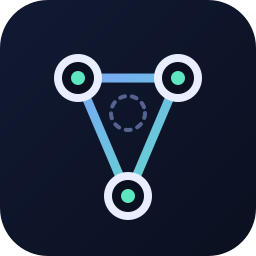
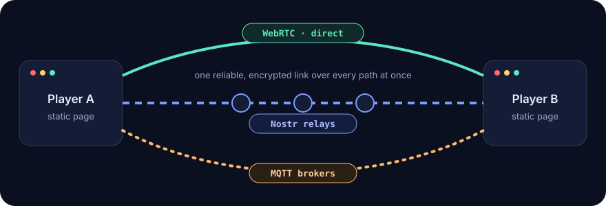

<div align="center">



# hostless

**Мультиплеер для статических сайтов, который не рвётся.**

WebRTC, когда он работает · публичные ретрансляторы, когда нет · матчи, которые переживают перезагрузку · прогресс на всех устройствах — и никакого своего сервера.

[English](README.md) | **Русский**

[](https://github.com/NELKIO/hostless/actions/workflows/ci.yml)
[](https://www.npmjs.com/package/hostless)
[](https://www.npmjs.com/package/hostless)
[](docs/testing.md)
[](#установка)
[](LICENSE)
[](https://github.com/NELKIO/hostless/stargazers)

[](https://www.typescriptlang.org/)
[](https://webrtc.org/)
[](https://nostr.com/)
[](https://mqtt.org/)
[](https://pages.github.com/)

[**Демо**](https://nelkio.github.io/hostless/) · [Документация](docs/architecture.md) · [npm](https://www.npmjs.com/package/hostless) · [Для ИИ-агентов](AGENTS.md)

</div>

<br>

<p align="center">
  
</p>

## Зачем

Вы сделали браузерную игру на GitHub Pages и хотите, чтобы друзья играли вместе, но без сервера,
базы данных, аккаунтов и ежемесячного счёта. Голый WebRTC решает задачу наполовину: он не проходит
через симметричный NAT, VPN, корпоративный Wi‑Fi и часть мобильных операторов, а перезагрузка
страницы теряет партию.

hostless — вторая половина. Он вынесен из трёх игр, в которые играли из разных стран через нестабильные сети:

<table>
<tr>
<td width="50%" valign="top">

🛰️ **Работает там, где WebRTC не работает**<br>
Каждое сообщение идёт по прямому каналу *и* переходит на публичные Nostr-релеи и MQTT-брокеры за один таймаут. Тот же матч, без экрана переподключения, без TURN-сервера.

</td>
<td width="50%" valign="top">

🧱 **Переживает плохую сеть**<br>
Нумерация, выборочные подтверждения, повторы по всем путям, контроль перегрузки и смена сокетов в обход DPI, который «замораживает» соединение после нескольких килобайт.

</td>
</tr>
<tr>
<td width="50%" valign="top">

💾 **Переживает вкладку**<br>
Ходы подписываются и записываются на диск *до* отправки. Перезагрузка, сбой, закрытый ноутбук — место возвращается с той же личностью и историей.

</td>
<td width="50%" valign="top">

📬 **Результат дождётся**<br>
Игрок, вернувшийся через несколько дней, получит проверенный итог матча из «почтового ящика» на релеях, даже если все остальные уже ушли.

</td>
</tr>
<tr>
<td width="50%" valign="top">

🔄 **Прогресс на всех устройствах**<br>
Зашифрованный CRDT-документ в Nostr, устройства связываются ключом в ссылке. Прогресс, набранный офлайн на двух устройствах, складывается и никогда не удваивается.

</td>
<td width="50%" valign="top">

🔐 **Приватно и без подделок**<br>
Комната выводится из кода медленной KDF; релеи видят случайные топики и шифротекст. Данные между игроками шифруются парным ключом; каждый ход, операция и hello подписаны Schnorr.

</td>
</tr>
</table>

## Содержание

[Установка](#установка) · [Полная игра](#полная-пошаговая-игра) · [Что будет, если…](#что-будет-если) ·
[Сессии](#три-вида-сессий) · [Синхронизация](#прогресс-на-всех-устройствах) · [Как это устроено](#как-это-устроено) ·
[Сравнение](#сравнение) · [Качество](#качество) · [Ограничения](#ограничения)

## Установка

```sh
npm i hostless
```

Без сборщика — браузерный бандл (Trystero для WebRTC подгружается лениво при первом использовании):

```html
<script type="module">
  import { createTurnMatch } from 'https://cdn.jsdelivr.net/npm/hostless/dist/browser/hostless.js';
</script>
```

## Полная пошаговая игра

```js
import { createTurnMatch, newRoomCode, parseRoomCode, inviteLink } from 'hostless';

// 1. Ваши правила — пять чистых функций. hostless выполняет их на каждом устройстве и проверяет каждый ход.
const ticTacToe = {
  setup: (lineups, { seed }) => ({ board: Array(9).fill(null), next: parseInt(seed[0], 16) % 2 }),
  turn: (s) => (s.winner != null || s.board.every(Boolean) ? null : s.next),
  apply: (s, seat, cell) => {
    if (s.board[cell] !== null) return null; // недопустимый ход отклоняется везде
    const board = s.board.with(cell, seat);
    const won = [[0,1,2],[3,4,5],[6,7,8],[0,3,6],[1,4,7],[2,5,8],[0,4,8],[2,4,6]].some((l) => l.every((i) => board[i] === seat));
    return { board, next: 1 - seat, winner: won ? seat : null };
  },
  result: (s) => (s.winner != null ? { winner: s.winner } : s.board.every((c) => c !== null) ? { winner: null, draw: true } : null),
};

// 2. Комната: создатель — хост, по ссылке заходит гость.
const joining = parseRoomCode(location.href);
const code = joining ?? newRoomCode();

const match = await createTurnMatch({
  app: { id: 'my-tic-tac-toe', protocol: 1 },
  code,
  role: joining ? 'guest' : 'host',
  engine: ticTacToe,
});
if (!joining) console.log('Приглашение:', inviteLink(code, { host: match.room.peerId }));
match.ready({ name: 'Аня' });

// 3. Игра.
match.on('change', () => render(match.state, match.myTurn));
match.on('result', (r) => alert(r.draw ? 'Ничья' : r.winner === match.mySeat ? 'Победа' : 'Поражение'));
board.onclick = (e) => match.move(Number(e.target.dataset.cell)); // false, если не ваш ход или ход недопустим
```

Это весь сетевой код. Перезагрузите страницу посреди партии — она продолжится.

## Что будет, если…

| ситуация | что делает hostless |
|---|---|
| у обоих игроков нормальная сеть | канал WebRTC, ~20–80 мс; по релеям идут только редкие пинги |
| WebRTC не соединяется (симметричный NAT, VPN, закрыт UDP) | те же сообщения идут через Nostr-релеи и MQTT-брокеры, обычно 150–600 мс |
| прямой канал молча умер посреди матча | неподтверждённые сообщения повторяются по всем путям через один таймаут (≈0,3–1 с), матч продолжается |
| релей замораживает сокет после ~12 КБ (DPI) | пропавший OK замечается за 1,5 с, его место занимает новый сокет, следующие сменяются ещё до заморозки |
| релей отказывает или режет по лимиту | он отключается на сессию, его место занимает резервный |
| сообщение потерялось, задвоилось или пришло не по порядку | нумерация, накопительные и выборочные подтверждения: ровно один раз и по порядку |
| игрок перезагрузил страницу или вкладка упала | место (личность и журнал) восстанавливается, матч сверяется по проверенной истории |
| игра открыта в двух вкладках | Web Locks отдают место одной вкладке, вторая узнаёт, что место занято |
| хранилище перестало принимать записи | ход, который нельзя сохранить, не отправляется (нельзя переходить ход после перезагрузки) |
| соперник закрыл игру насовсем | его место «ждёт»; если он доиграл, итог берётся из почтового ящика на релеях и проверяется |
| код комнаты есть у кого-то ещё | код — это приглашение: войти можно, подделать чужие ходы или личность нельзя; ссылка может назвать хоста, и гости проигнорируют остальных |
| у соперника старая версия | разные протоколы не соединяются, разные правила обнаруживаются на старте (`stop: 'version'`) |

## Три вида сессий

| | для чего | как |
|---|---|---|
| **`TurnMatch`** | шахматы, карты, дуэли, крестики-нолики | 2–N мест, детерминированный движок на каждом устройстве, подписанные ходы, журнал до отправки, восстановление, почтовый ящик |
| **`Replica`** | кооперативные поля, общий холст, списки | подписанный лог операций, причинная доставка, анти-энтропия, одинаковый порядок везде, кешированная свёртка |
| **`HostAuthority`** | скрытая информация, много игроков, тяжёлые правила | хост проверяет каждое действие, гости держат теневую копию и сверяют хеш |

```js
import { createReplica } from 'hostless';

const canvas = await createReplica({ app: { id: 'paint', protocol: 1 }, code });
canvas.push({ x: 3, y: 7, color: 'red' });          // подписано, сохранено, разослано
canvas.on('op', ({ op }) => drawPixel(op));         // рисуют все одновременно
const picture = canvas.fold(applyPixel, blank);     // одинаково на каждом экране
```

Можно и без сессий, напрямую через комнату: `const room = await joinRoom({ app, code }); room.channel('chat').broadcast('привет')`.

## Прогресс на всех устройствах

```js
import { createDeviceSync, DeviceSync, ledger, deviceId } from 'hostless';

const me = deviceId('my-game');
const sync = createDeviceSync({
  app: 'my-game',
  store: { read: () => save, write: (next) => persist(next) },
  merge: (local, remotes) => ({ xp: remotes.reduce((l, r) => ledger.merge(l, r.xp), local.xp) }),
});
await sync.link(DeviceSync.newKey());                    // первое устройство; следующему — ссылку `#sync=KEY`
save = { xp: ledger.record(save.xp, me, { xp: 120 }) };   // офлайн-прогресс двух устройств складывается
```

А ещё **`PublicStats`** — каждый браузер публикует свои числа, любой может их сложить — и
**`checkNetwork()`**, который показывает игроку, до каких релеев достаёт его сеть и вероятен ли прямой WebRTC.

Необязательные виджеты без фреймворков: `<hostless-lobby>` (создать / войти / поделиться), `<hostless-link>`
(прямой канал или релей, пинг), `<hostless-sync>` (связать устройства), `<hostless-netcheck>`.

## Как это устроено

```
 сессии     TurnMatch · Replica · HostAuthority
 комната    подписанные hello, игроки, присутствие, версии, каналы
 link       нумерация / ACK / SACK / RTO / окно перегрузки / фрагментация / сжатие   ← по одному на игрока
 пути       WebRTC (Trystero) · Nostr-релеи · MQTT-брокеры · BroadcastChannel    ← все сразу
 крипто     PBKDF2-топики · AES-GCM · Schnorr (BIP-340) · x-only ECDH
```

Код комнаты превращается в публичный топик через 60 000 раундов PBKDF2; hello шифруются ключом
комнаты и подписываются; данные между двумя игроками шифруются их парным ECDH-ключом. Пока прямой
канал здоров, link пользуется им, иначе — всеми релеями сразу.
Подробнее: [архитектура](docs/architecture.md) · [сессии](docs/sessions.md) · [синхронизация и статистика](docs/sync.md) ·
[модель безопасности](docs/security.md) · [тестирование игры](docs/testing.md) · [публичные серверы](docs/endpoints.md) (на английском).

### Проверено в бою

hostless объединяет и укрепляет сетевую часть трёх игр:
[influence-web](https://github.com/NELKIO/influence-web) (многопутевые соединения, Nostr в обход DPI, MQTT, комнаты с хостом),
[RU-Fast-Food-Locator-Game](https://github.com/NELKIO/RU-Fast-Food-Locator-Game) (подписанные места, восстанавливаемые
дуэли, почтовый ящик, синхронизация устройств — играли из разных стран через VPN и мобильные сети) и
[hexceed-web](https://github.com/NELKIO/hexceed-web) (кооперативный лог операций). Настоящий боевой движок
локатора работает на `TurnMatch` без правок прямо в тестах.

## Сравнение

Из коробки, без своего сервера:

| | hostless | Trystero | PeerJS | y-webrtc | хостинги (Playroom, Photon…) |
|---|:-:|:-:|:-:|:-:|:-:|
| без своего сервера | ✅ | ✅ | ⚠️ публичный PeerServer | ⚠️ сигнальный сервер | ❌ бэкенд вендора |
| работает, когда WebRTC не может | ✅ релеи | ❌ (TURN опционально) | ❌ | ❌ | ✅ |
| надёжно и по порядку при смене пути | ✅ | — | — | — | ✅ |
| матч переживает перезагрузку | ✅ | ❌ | ❌ | ⚠️ только документ | ⚠️ |
| проверяемые ходы, защита от подделок | ✅ подписи | ❌ | ❌ | ❌ | ⚠️ |
| прогресс между устройствами без аккаунтов | ✅ | ❌ | ❌ | ❌ | ❌ |

Trystero отлично делает своё дело — hostless использует его для WebRTC.

## Качество

- **190 модульных и интеграционных тестов** на имитациях сети, релеев и брокеров с ручными часами:
  фаззинг link при 40 % потерь, дублях и перестановках; свойства CRDT проверяются генеративно; каждая
  сессия — через сбои, перезагрузки, подделки и несовпадения версий.
- **8 браузерных сценариев** в двух изолированных профилях Chromium с настоящим WebRTC: прямой канал,
  только Nostr, только MQTT, WebRTC убит посреди матча, перезагрузка посреди матча, итог из почтового
  ящика, кооперативный холст, синхронизация устройств — на локальных серверах в CI и через
  **публичную инфраструктуру** командой `npm run test:live`.
- Независимое ревью; каждая находка исправлена и закрыта регрессионным тестом.

## Ограничения

- Публичные релеи держат энтузиасты и компании, с которыми у вас нет договора. hostless распределяет
  трафик и переживает потерю большинства из них, но **для коммерческой игры добавьте свой релей**
  (любой NIP-01-релей, любой MQTT-брокер) первым в списки.
- Задержки релеев подходят пошаговым и неторопливым играм в реальном времени, но не шутерам.
- Код комнаты — это приглашение; итоги `PublicStats` может накрутить кто угодно.
- В `HostAuthority` нет переноса хоста: если страница хоста закрыта, комната его ждёт.

## Разработка

```sh
npm test               # модульные и интеграционные тесты
npm run test:browser   # Chromium × 2, настоящий WebRTC, локальные релеи
npm run test:live      # то же через публичные релеи и брокеры
npm run scan           # перепроверить публичные серверы по умолчанию
npm run demo           # собрать и открыть демо на http://127.0.0.1:4321
```

Пул-реквесты приветствуются — см. [CONTRIBUTING](CONTRIBUTING.md). Работаете с ИИ-агентом? Дайте ему
[AGENTS.md](AGENTS.md) (или [CLAUDE.md](CLAUDE.md) для Claude Code).

<div align="center">

MIT © [NELKIO](https://github.com/NELKIO)

</div>
